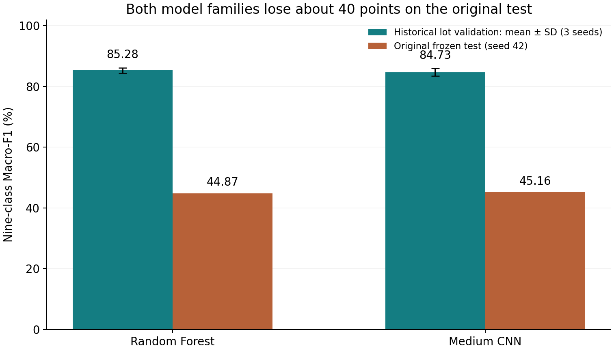

# Reliable Wafer Defect Classification
### Generalization, Rare-Class Detection, and Decision Trade-offs

A WM-811K case study in classifying wafer defects, tracking false alarms on normal wafers and allocating a limited number of human inspections.

**Status.** Research prototype. The original frozen test measured a substantial generalization gap. Later experiments used a previously inspected development audit. A new, representative set of independently labeled lots is needed for a production decision.

## Key findings

- **Original test.** RF/CNN lot-validation Macro-F1 of 85.28%/84.73% fell to 44.87%/45.16%. Normal wafers made up 67.57% of labeled development wafers and 93.34% of labeled test wafers. Of the CNN’s normal-to-Scratch errors, 97.31% occurred at dimensions with fewer than 25 development normals. [Error analysis](docs/ERROR_ANALYSIS.md)
- **Geometry.** Adding six spatial features to the RF raised mean audit Scratch recall from 32.08% to 42.08% and reduced total false alarms from 12.35 to 7.17 per 1,000 normals. [Geometry ablation](reports/Project_Report.md)
- **CNN training and inspection.** The five-arm comparison retained standard cross-entropy. A separate masked pretraining pilot found additional scratches at the expense of more normal-wafer alarms. A capacity simulation quantified which defects each inspection queue missed. [Development results](cloud_review/results/full/SUMMARY.md)



## Five CNN training methods and a fixed review budget

Fifteen fits shared the same medium CNN, training rows, optimizer, seven supervised epochs and seeds 42, 123 and 2026. Lots and identical-image groups stayed together. The 11,307 validation wafers were split by group into 5,637 for calibration and 5,670 for model and threshold selection. The audit contained 80 true scratches and 7,991 normals. The table averages the three seeds on those same wafers.

| Training method | Audit Macro-F1 | Scratch recall | Normal wafers called any defect |
|---|---:|---:|---:|
| Standard cross-entropy (CE) | 83.43% | 43.75% | 3.03% |
| Class-weighted CE | 72.75% | 44.17% | 30.29% |
| Weighted sampling | 75.72% | 74.17% | 26.91% |
| 180° rotation | 79.26% | 41.25% | 5.99% |
| Focal loss | 80.62% | 36.25% | 3.23% |

CE ranked first on validation Macro-F1 (84.33%). A stricter selection rule required each seed to retain CE’s true Scratch hits while increasing neither total normal false alarms nor normal-to-Scratch errors. Only CE qualified. Its separate validation-tuned Scratch threshold passed all three conditions on zero of three audit seeds. [Five-arm evaluation](cloud_review/results/full/SUMMARY.md) · [Guarded comparison](cloud_review/results/guarded/guarded_summary.json)

**Self-supervised pilot.** One seed received 391 additional masked-density updates on 50,000 isolated, unlabeled maps before the same seven supervised epochs. Against its matched CE control, audit Scratch hits rose from 38 to 45 of 80, normal false alarms rose from 264 to 328, and normal-to-Scratch errors rose from 205 to 208. The pilot failed the joint criteria on both validation and audit. [Paired pilot results](cloud_review/results/ssl_paired/pilot_summary.json)

**Inspection capacity.** A shared historical screen flagged 3,642 of 11,591 audit arrivals. Reviewing at most 200 per 1,000 flagged wafers allowed 728 inspections. With a hypothetical $3,000 missed Scratch, $1,000 other missed defect and $5 inspected normal, CE’s expected-net-benefit ranking sent 47.7 true scratches to review on average, compared with 15 under seeded random selection and zero under defect-probability ranking. Simulated costs were $257,722, $261,422 and $261,582, respectively, per 1,000 **arrivals**, including misses outside the screen. A lower-cost unconstrained threshold needed 5,472 inspections on average. [Cost and queue results](cloud_review/results/full/SUMMARY.md) · [Reproduction guide and notebook](cloud_review/extension/README.md)

## Earlier geometry ablation

Same fixed train/tune/audit rows; 3 seeds; six new RF fits and three reused, lineage-checked CNN fits. Audit support: 80 Scratch and 7,991 normal wafers. Means across seeds below do not create additional independent examples.

| Model / nine-class argmax | Macro-F1 | Scratch precision | Scratch recall | Scratch AP | Normal→any / 1,000 | Normal→Scratch / 1,000 |
|---|---|---|---|---|---|---|
| RF · 71 original features | 83.88% | 50.27% | 32.08% | 0.3186 | 12.35 | 0.584 |
| RF · 71 + 6 geometry features | 87.22% | 90.14% | 42.08% | 0.5599 | 7.17 | 0.125 |
| CNN · matched training rows | 82.39% | 20.10% | 49.58% | 0.3004 | 33.12 | 20.231 |

The original 71 features already include covariance. PCA anisotropy is a re-expression of that information; the experiment tests a six-feature block including narrow-strip organization. It cannot attribute the gain to PCA alone. A fresh independent test of the new candidate is unavailable.

Scratch AP in the geometry table uses archived raw probabilities. The newer decision report uses temperature-calibrated nine-class probabilities. For RF77 the corresponding APs are 0.5599 and 0.5929. Multiclass normalization can change the ranking of Scratch probabilities across wafers while preserving each wafer’s nine-class argmax. [Calibration and per-class metrics](cloud_review/results/full/SUMMARY.md)

## Read the project

- [Which wafers traded review slots? (中文)](cloud_review/exchange_08/HISTORICAL_EXCHANGE.zh-CN.md) compares only the wafers selected by one strategy. In the primary run, 3,054 of the 3,352 extra normal reviews came from sizes with no matching normal training wafers. [Prospective blind evaluation protocol](cloud_review/blind_review_08/PROTOCOL.zh-CN.md)
- [Frozen review queues on the historical test lots (中文)](cloud_review/roadmap_07/REPORT.zh-CN.md) measures how many inspection slots went to normal wafers at dimensions absent from development normals. It replays the same models and costs after excluding directly duplicated maps and entire components connected to development.
- [English project report](reports/Project_Report.md) — protocols, final-test degradation, ablation, PR decisions and limitations.
- [中文技术总结](docs/TECHNICAL_SUMMARY.zh-CN.md) — 用中文解释结果与取舍。
- [Error analysis and real Scratch examples](docs/ERROR_ANALYSIS.md).
- [Model Card](docs/MODEL_CARD.md), [evaluation history](docs/EVALUATION_HISTORY.md), [experiment journal](docs/EXPERIMENT_JOURNAL.md).
- [Reproducibility](docs/REPRODUCIBILITY.md), [AI assistance](docs/AI_ASSISTANCE.md), [interview preparation](Technical%20Interview%20Preparation.md), [resume bullets](docs/RESUME_BULLETS.md).

## Quick start

Use Python 3.10 or 3.11 and a fresh environment. The following installs the RF pipeline and tests; CNN dependencies are optional.

```bash
python -m venv .venv
# Activate .venv using your shell's normal command.
python -m pip install -r requirements.txt
python -m pip install -e ".[test]"
python -m pytest -q
python scripts/verify_provenance.py
python scripts/recompute_decisions.py
```

Metric replay uses the committed compressed prediction tables and needs no raw dataset or model training. See the [reproduction guide](docs/REPRODUCIBILITY.md) for verified dataset acquisition, the fixed split, CPU/GPU setup and full training commands. The original raw data and checkpoint binaries are intentionally external; weights can be recreated or recovered from the recorded historical Kaggle outputs.

## Repository map

```text
src/waferdefect/       Data, split, RF/CNN, geometry, evaluation and freeze CLI
configs/              Reusable bounded experiment configurations
tests/                Split, label, preprocessing, metric and protocol checks
scripts/              Integrity checks, metric replay and engineering smoke run
data-reference/       Compact metadata, fixed split and original-data checksum
results/              Actual historical / exploratory scores, freezes and checks
reports/              English report and source-backed figures
docs/                 Error analysis, Model Card, Chinese summary and explanation
cloud_review/         Hosted training, review policies, capacity simulation and aggregate evidence
```

## Data and sources

[WM-811K dataset](https://www.kaggle.com/datasets/qingyi/wm811k-wafer-map). The study preserves the original labeled development/test designation and documents exact-map overlap and label conflicts. [Recorded Kaggle versions and verification history](docs/EVALUATION_HISTORY.md). Obtain data under the provider's terms; this repository does not redistribute the full dataset.

The existing official test was examined after its first frozen evaluation. Subsequent ideas and development audit results are exploratory; they must not be represented as a second pristine final test. AI contributed to implementation, execution and documentation; this is disclosed and does not imply completed personal human review.
