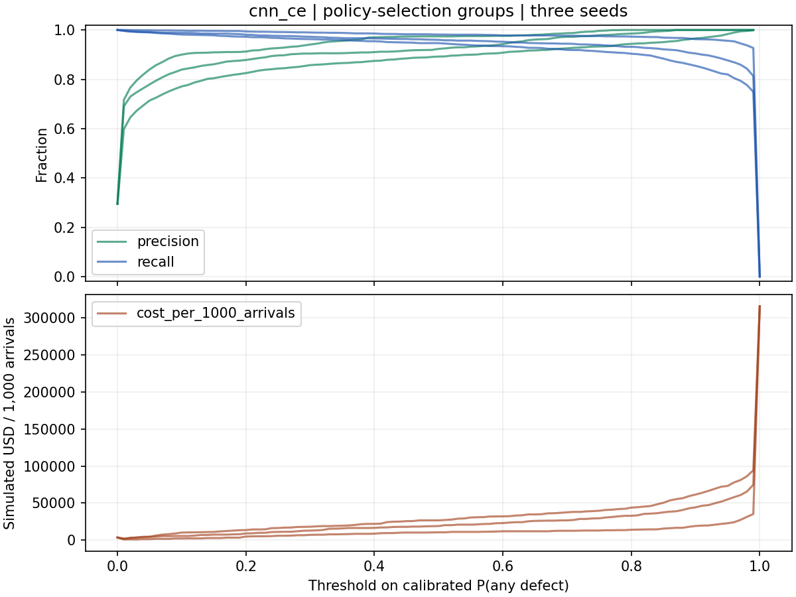
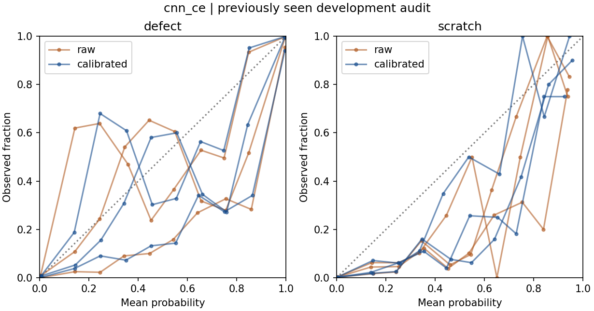

# WM-811K · Development experiment results

Previously inspected development audit. Each row averages three training seeds on the same wafers. Mean counts can be fractional.

Disjoint tune components fit the temperature and select policies. The training arm and thresholds were frozen before loading audit scores.

## Sample composition

| Partition | N | Normal | Defect | Scratch | Normal share |
| --- | --- | --- | --- | --- | --- |
| train | 31,457 | 20,780 | 10,677 | 321 | 66.06% |
| calibration | 5,637 | 3,960 | 1,677 | 39 | 70.25% |
| selection | 5,670 | 3,999 | 1,671 | 60 | 70.53% |
| audit | 11,591 | 7,991 | 3,600 | 80 | 68.94% |

These proportions describe labeled wafers in each development partition. The raw archive, the full labeled population, and production arrivals have distinct denominators.

## Training and nine-class predictions

| Model | Macro-F1 | Scratch P | Scratch R | Scratch AP | Normal FPR | Normal→Scratch |
| --- | --- | --- | --- | --- | --- | --- |
| RF71 | 83.88% | 50.27% | 32.08% | 34.19% | 1.23% | 4.7 |
| RF77 | 87.22% | 90.14% | 42.08% | 59.29% | 0.72% | 1.0 |
| CNN (archived) | 82.39% | 20.10% | 49.58% | 29.86% | 3.31% | 161.7 |
| RF77 + CNN (50/50) | 85.47% | 42.20% | 48.75% | 51.58% | 1.56% | 58.3 |
| CNN CE | 83.43% | 18.88% | 43.75% | 28.25% | 3.03% | 152.0 |
| CNN weighted loss | 72.75% | 13.44% | 44.17% | 22.78% | 30.29% | 398.0 |
| CNN weighted sampling | 75.72% | 22.04% | 74.17% | 41.85% | 26.91% | 1,081.3 |
| CNN 180° rotation | 79.26% | 24.65% | 41.25% | 35.39% | 5.99% | 114.0 |
| CNN focal | 80.62% | 24.62% | 36.25% | 26.56% | 3.23% | 106.7 |

Validation chose CNN CE. The five new CNN arms share architecture, split and seeds; assess weighting, sampling, rotation or focal loss against the fresh CE control.

For CNN CE, the Scratch-priority rule changed true Scratch hits by 0.0, total false alarms on normal wafers by -1.0, and normal-to-Scratch predictions by -3.3 versus argmax. All three guards held on audit for 0/3 seeds.

Validation retained the original argmax rule for 0/3 seeds.

Before and after temperature scaling, multiclass NLL was 0.143 → 0.142, multiclass Brier 0.067 → 0.067, and any-defect ECE 2.75% → 2.42%.

For exact zero raw probabilities, NLL uses a numerical floor of 1e-300. Temperature scaling first floors input probabilities at 1e-12, so the NLL comparison includes smoothing of zeros.

## Thresholds, inspection slots and costs

Both hypothetical scenarios assign $1,000 per missed ordinary defect and $5 per inspected normal wafer with perfect human inspection. The cost columns assume $1,000 and $3,000 per missed Scratch. All-arrival denominators include wafers excluded by the upstream gate.

| Stage | Reviewed¹ | FN¹ | FP¹ | USD/1k ($1k Scratch) | USD/1k ($3k Scratch) |
| --- | --- | --- | --- | --- | --- |
| Archived RF71 | 3,549.3 | 149.3 | 98.7 | 12,926 | 17,412 |
| CNN CE control | 3,698.3 | 143.7 | 242.0 | 12,499 | 18,366 |
| Selected training arm | 3,698.3 | 143.7 | 242.0 | 12,499 | 18,366 |
| F1 threshold | 3,598.7 | 175.7 | 174.3 | 15,231 | 21,212 |
| Cost threshold | 5,472.0 | 8.0 | 1,880.0 | 1,344 | 2,249 |
| Capacity within the gate | 728.0 | 2,922.3 | 50.3 | 247,778 | 257,722 |

¹ Reviews, FN and FP use the $3,000 Scratch scenario. Thresholds can route different numbers under different cost assumptions. Capped rankings enforce a 20% limit in each simulated batch.

| Common-pool rank | Flagged | Reviewed | Scratch found | Gate FN | In-pool FN | FP | USD/1k |
| --- | --- | --- | --- | --- | --- | --- | --- |
| Random | 3,642 | 728 | 15.0 | 116.0 | 2,784.0 | 28.0 | 261,422 |
| Defect probability | 3,642 | 728 | 0.0 | 116.0 | 2,756.0 | 0.0 | 261,582 |
| Expected net benefit | 3,642 | 728 | 47.7 | 116.0 | 2,806.3 | 50.3 | 257,722 |

All rankings share the historical RF71 gate and inspect up to 200 of 1,000 flagged wafers per batch, rounding down in the final partial batch. The random comparator hashes wafer IDs. Actual arrival times, inspection efficacy and monetary costs have not been observed.

At fixed capacity, replacing RF71 with CNN CE saved a simulated $-952.6 per 1,000 arrivals. The paired component bootstrap 95% interval was [-8,257.2, 6,787.4], conditional on fitted models and these queues.

Per-class metrics and confusions are in per_class.csv.gz and confusion.csv.gz; routing.csv.gz gives per-seed cost results. The frozen policy file records the fitted choices.
