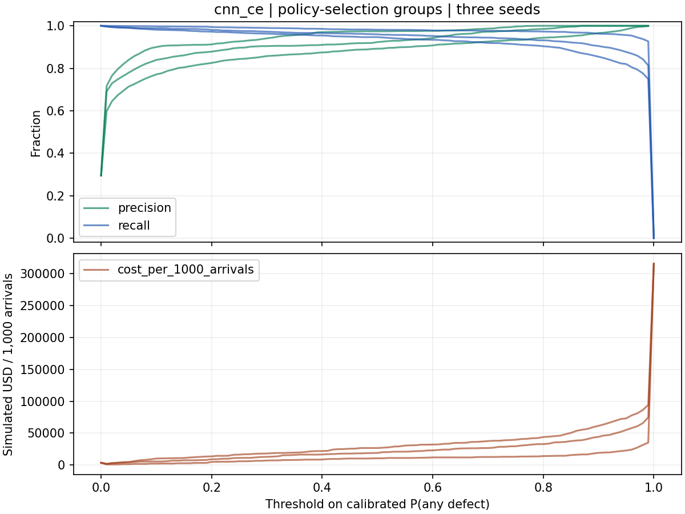
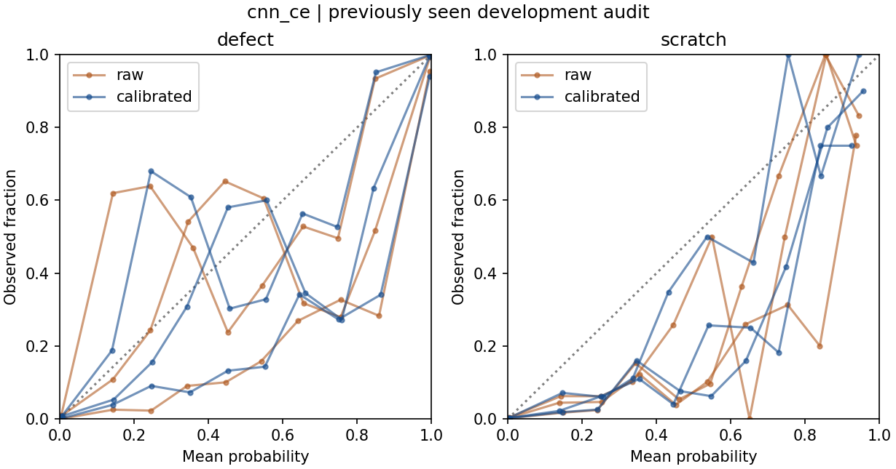

# WM-811K · 开发集实验汇总

已查看过的开发集 audit。表中每行是三个训练种子在同一组晶圆上的平均值。计数取平均后可有小数。

校准温度和选择策略使用 tune 中不重叠的组件。入选训练臂及其阈值在读取 audit 分数前冻结。

## 样本与划分

| 组成 | N | 正常 | 缺陷 | Scratch | 正常占比 |
| --- | --- | --- | --- | --- | --- |
| train | 31,457 | 20,780 | 10,677 | 321 | 66.06% |
| calibration | 5,637 | 3,960 | 1,677 | 39 | 70.25% |
| selection | 5,670 | 3,999 | 1,671 | 60 | 70.53% |
| audit | 11,591 | 7,991 | 3,600 | 80 | 68.94% |

占比的分母是相应开发分区的有标签晶圆。原始 WM-811K、完整有标签总体以及生产来料的分布须分别报告。

## 训练方法与九分类性能

| 模型 | Macro-F1 | Scratch P | Scratch R | Scratch AP | 正常总误报率 | 正常→划痕数 |
| --- | --- | --- | --- | --- | --- | --- |
| RF71 | 83.88% | 50.27% | 32.08% | 34.19% | 1.23% | 4.7 |
| RF77 | 87.22% | 90.14% | 42.08% | 59.29% | 0.72% | 1.0 |
| CNN (archived) | 82.39% | 20.10% | 49.58% | 29.86% | 3.31% | 161.7 |
| RF77 + CNN (50/50) | 85.47% | 42.20% | 48.75% | 51.58% | 1.56% | 58.3 |
| CNN CE | 83.43% | 18.88% | 43.75% | 28.25% | 3.03% | 152.0 |
| CNN weighted loss | 72.75% | 13.44% | 44.17% | 22.78% | 30.29% | 398.0 |
| CNN weighted sampling | 75.72% | 22.04% | 74.17% | 41.85% | 26.91% | 1,081.3 |
| CNN 180° rotation | 79.26% | 24.65% | 41.25% | 35.39% | 5.99% | 114.0 |
| CNN focal | 80.62% | 24.62% | 36.25% | 26.56% | 3.23% | 106.7 |

验证阶段选定 CNN CE。新训练的五个 CNN 臂共享架构、拆分和种子，比较加权、采样、旋转或 focal 的增量应以新 CE 臂为对照。

在 CNN CE 上，划痕优先阈值相对九分类 argmax 的平均变化为：正确划痕数 0.0，正常总误报数 -1.0，正常误判划痕数 -3.3。0/3 个种子在 audit 上同时守住三个约束。

其中 0/3 个种子在验证阶段保留了原 argmax 规则。

该模型温度校准前后，多类 NLL 为 0.143 → 0.142，多类 Brier 为 0.067 → 0.067，任意缺陷 ECE 为 2.75% → 2.42%。

原始分数含精确零时，NLL 对数计算使用极小值 1e-300。温度变换先将概率下限设为 1e-12，因此两种 NLL 的差也包含对零概率的平滑效果。

## 阈值、检验名额与成本

两种假设都将错过普通缺陷的损失设为 $1,000、额外复检正常晶圆的成本设为 $5，人工检查可识别全部送检缺陷。两个成本栏分别将漏掉划痕设为 $1,000 和 $3,000。全来料分母包括被初筛排除的晶圆。

| 层级 | 复检数¹ | FN¹ | FP¹ | USD/1k ($1k Scratch) | USD/1k ($3k Scratch) |
| --- | --- | --- | --- | --- | --- |
| 历史 RF71 | 3,549.3 | 149.3 | 98.7 | 12,926 | 17,412 |
| CNN 交叉熵对照 | 3,698.3 | 143.7 | 242.0 | 12,499 | 18,366 |
| 入选训练臂 | 3,698.3 | 143.7 | 242.0 | 12,499 | 18,366 |
| F1 阈值 | 3,598.7 | 175.7 | 174.3 | 15,231 | 21,212 |
| 成本阈值 | 5,472.0 | 8.0 | 1,880.0 | 1,344 | 2,249 |
| 候选池内限额复检 | 728.0 | 2,922.3 | 50.3 | 247,778 | 257,722 |

¹ 复检、FN、FP 列使用划痕 $3,000 的情境。阈值在不同成本假设下可选出不同复检数，名额策略始终遵守每个模拟批次的 20% 硬上限。

| 同池排序 | 已标记 | 复检 | 复检划痕 | 池外 FN | 池内 FN | FP | USD/1k |
| --- | --- | --- | --- | --- | --- | --- | --- |
| 随机 | 3,642 | 728 | 15.0 | 116.0 | 2,784.0 | 28.0 | 261,422 |
| 缺陷概率 | 3,642 | 728 | 0.0 | 116.0 | 2,756.0 | 0.0 | 261,582 |
| 预期净收益 | 3,642 | 728 | 47.7 | 116.0 | 2,806.3 | 50.3 | 257,722 |

同一批历史 RF71 初筛候选按批次最多取 200/1,000，尾批按比例向下取整。随机策略使用固定的晶圆标识散列。固定队列是模拟场景，尚缺真实批次到达时间、人工检查效果和成本记录。

相同名额下，将 RF71 替换为 CNN CE 的模拟节省为每千片 $-952.6，配对组件 bootstrap 95% 区间 [-8,257.2, 6,787.4]。区间将队列和已训练模型视为固定。

逐类指标和混淆见 per_class.csv.gz 与 confusion.csv.gz，所有策略的逐种子成本见 routing.csv.gz。冻结文件记录参数和模型选择过程。
