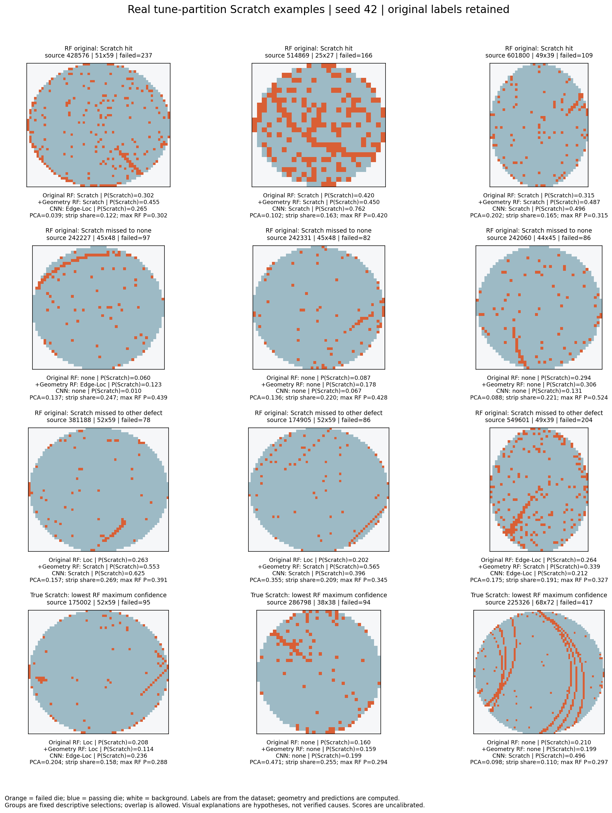

# Error Analysis Report

## Scope and evidence labels

Historical original-test diagnosis and this final development round are distinct. The original test was already examined after its frozen evaluation. The new error cohorts and gallery use only the preserved development partition. No test score was used to choose a new candidate in this round; the research direction is nevertheless informed by earlier diagnosis.

**Computed evidence** means counts, saved scores, original dimensions, failed-die counts, content hashes or fixed feature calculations. **AI visual observation** describes visible patterns in the gallery without asserting a physical cause. **Unverified hypotheses** include annotation ambiguity, a particular process mechanism, and noise/discontinuity as the reason for a given prediction. Dataset labels are retained, not adjudicated.

## Historical failure: normal wafers predicted as Scratch

The historical CNN classified 35,195 original-test normal wafers as Scratch and 58,728 as any defect, among 110,701 normals. Its higher Scratch recall (374/693) coexisted with approximately 1.03% Scratch precision. RF detected only 27/693 true scratches. This is why neither accuracy nor isolated recall describes a successful system.

70.60% of original-test normal wafers have exact dimensions absent from development normals; 97.31% of CNN normal→Scratch errors belong to dimensions supported by only 0–24 development-normal examples. Geometry may encode product/lot differences, so these are descriptive associations rather than causal percentages. Source/label replay did not reveal a simple index or class-order corruption explanation.

A diagnostic recalculation of BatchNorm statistics used 4,096 development samples with natural class proportions, including all nine classes. It reduced Scratch predictions in a fixed 300-false-alarm gallery from 300 to 7, but true Scratch recall fell from 53.97% to 12.12%. It was not accepted as a repair. Subsequent development repair candidates likewise had to preserve true Scratch detection and normal total specificity, including after refitting.

## Fixed geometry ablation: measured cohorts

The fixed geometry block improved the RF on the **previously observed development audit**, while leaving substantial Scratch misses. Seeds 42, 123 and 2026 used the same 31,457 training wafers, unchanged RF hyperparameters and identical evaluation rows. On 80 audit Scratch wafers, correct predictions rose from **25/26/26 to 31/35/35**. Mean Scratch recall increased from 32.08% to 42.08%, precision from 50.27% to 90.14%, and Macro-F1 from 0.8388 to 0.8722. All three seeds passed the frozen joint point-estimate guardrails; this is exploratory evidence, not a new independent test or a model promotion.

Among 7,991 normal audit wafers, normal-to-Scratch errors fell from **9/3/2 to 1/1/1** and total normal-to-defect errors from **108/90/98 to 61/55/56**. The old normal-to-Scratch errors corrected by the geometry RF went to `none`, with zero transfers to other defect labels. Each seed also introduced one new normal-to-Scratch error. The gain therefore survives a total-false-positive check, but does not mean every individual wafer improved.

Normal size coverage remains a useful diagnostic. The 643 normal wafers whose exact original height/width had no normal training examples contained all original-RF normal-to-Scratch errors and all three residual geometry-RF errors. Total false positives in this subgroup fell from 104/86/93 to 54/50/50. In the well-covered subgroup of 7,298 normal wafers, total false positives increased slightly from 3/3/4 to 6/4/5. This concentration is descriptive: size may proxy lot or other distribution differences and was not randomized.

The following counts are true Scratch hits, in seed order 42/123/2026. Strata use fixed, pre-score definitions and the same wafers for both RF variants.

| Audit Scratch stratum | Wafers | Original RF | RF + geometry |
|---|---:|---:|---:|
| Maximum original side <=32 dies | 13 | 0/0/0 | 0/0/0 |
| Maximum side 33–64 | 38 | 14/14/14 | 17/19/18 |
| Maximum side >=65 | 29 | 11/12/12 | 14/16/17 |
| 50–199 failed dies | 56 | 13/14/14 | 21/24/24 |
| >=200 failed dies | 23 | 12/12/12 | 10/11/11 |
| Best-strip failure share [0.2, 0.5) | 27 | 2/4/3 | 10/12/11 |
| Best-strip failure share <0.2 | 53 | 23/22/23 | 21/23/24 |

The block helps the moderate-failure and more concentrated-strip strata, but hurts the >=200-failure stratum and does not recover any of the 13 small Scratch wafers. Only one audit Scratch wafer has fewer than 50 failed dies; it is missed by every model/seed, so this sample cannot support a general conclusion about very sparse scratches. At a failure rate of at least 10%, the geometry RF still hits only 5/6/6 of 25 wafers. These are overlapping descriptive strata, not isolated causal effects.

The linearity measurements are also limited. Sixty-six of 80 audit Scratch wafers have global PCA anisotropy below 0.25; none reaches 0.5. No audit Scratch wafer puts at least half of all failures inside the best fixed two-die strip. Thus, a labeled Scratch need not look like one globally dominant straight line. The original 71 features already contain the full covariance; PCA anisotropy was reconstructed from those moments on all 54,355 development wafers (maximum absolute difference about 8.71e-8). The experiment tests a six-feature block containing this re-expression and five strip descriptors; it cannot attribute the improvement to PCA alone.

Miss destinations remain concentrated in `none` and `Loc`. Original RF predicts `none` for 28/26/24 of the 80 Scratch wafers and `Loc` for 17/20/18; geometry RF predicts `none` for 26/25/25 and `Loc` for 13/12/12. Geometry RF still gives maximum class probability below 0.5 on 53/51/50 Scratch wafers. These probabilities are uncalibrated; the 0.5 cutoff is a descriptive flag, not a newly selected decision rule.

None of the 80 audit Scratch wafers has an exact-map conflicting-label flag within the original development data. This does not certify annotation quality or rule out visually ambiguous classes. The 12-image tune gallery retains dataset labels and shows actual original maps, computed geometry, and saved predictions. Claims that noise, discontinuity or annotation ambiguity caused a particular error remain conjecture; no labels were changed or examples removed.

Paired percentile intervals use 2,000 lot/hash-component bootstrap draws. The cross-seed mean is computed on each wafer before resampling, so three seeds do not triple the sample size. The 80 Scratch wafers occupy 76 components; 7,991 normal wafers occupy 344 components. Geometry minus original RF has:

| Audit change, averaged over the three fixed seeds | Estimate | Conditional 95% interval |
|---|---:|---:|
| Scratch recall | +10.00 percentage points | +0.85 to +19.83 points |
| Normal-to-Scratch rate | -0.0459 percentage points | -0.0949 to -0.0044 points |
| Normal-to-any-defect rate | -0.5172 percentage points | -0.8920 to -0.2112 points |

The seed-42 Scratch-recall interval crosses zero (-2.60 to +18.30 points); the seed-123 normal-to-Scratch interval includes zero and seed 2026 crosses zero. The intervals are exploratory and conditional on these already observed data, this fixed split, and these models. They do not correct for earlier development decisions or prove significance for every seed. The pre-existing CNN reference has higher mean argmax Scratch recall (49.58%) but much lower precision (20.10%), more normal-to-Scratch errors (227/18/240), and wider seed variation; this is a tradeoff, not a universal model ranking. Tune-selected operating-point results are reported separately by the PR analysis.

Evidence: `metrics.csv`, `per_class.csv`, `confusions.csv`, `error_strata.csv`, `scratch_predictions.csv`, `scratch_error_cohorts.csv`, `delivery_evidence.json`, `conclusion.json`, `gallery_selection.json`, and `pca_redundancy_audit.json`. Counts and class probabilities passed a separate recomputation in `protocol_pr/independent_pr_geometry_audit.json`.

## Real Scratch gallery

These are twelve deterministically selected **tune** examples with the original dataset Scratch label and seed-42 predictions. Groups show RF hits, misses to normal, misses to another defect, and low maximum RF confidence. Groups are descriptive and may overlap. The image contains original categorical maps, not generated examples or model saliency.

AI visual observations: some examples contain short border-adjacent diagonal runs, isolated failures and local clusters in the same map; some are curved or have several separate lines. The long multi-curve example at source row 225326 remains normal under both RF decisions despite visible structure. Such observations help formulate failure hypotheses; they do not prove the dataset label is correct or identify a physical scratch mechanism. Computed labels, predictions, source rows and feature values are in [gallery selection](../results/geometry/gallery_selection.json).

## A threshold can hide error transfers

At frozen 80%-precision thresholds, the geometric RF loses 2/6/4 audit Scratch hits and adds 2/1/3 normal total false alarms versus its own argmax. For the CNN reference, 125/4/209 previous normal→Scratch errors become other defects. Counting only Scratch false alarms would hide those transfers. No threshold rule is accepted as a joint repair. [Paired decision table](../results/protocol_pr/decision_tradeoffs.csv).

The existing positive geometry result does not settle retraining stability, chronological generalization or label quality. The 13 small audit Scratch maps are all still missed. The next evidence needed is new data and expert review, not another unbounded architecture search on this audit.

## Inspectable sources

- [Every Scratch prediction and score](../results/geometry/scratch_predictions.csv)
- [Size, failure-count and geometry strata](../results/geometry/error_strata.csv)
- [Hit/miss cohorts](../results/geometry/scratch_error_cohorts.csv)
- [Full nine-class confusion counts](../results/geometry/confusions.csv)
- [Paired uncertainty and limits](../results/geometry/conclusion.json)
- [Original final-test metrics](../results/historical/cnn_and_final/final_test_per_class.csv)
- [AI assistance and personal verification](AI_ASSISTANCE.md)
