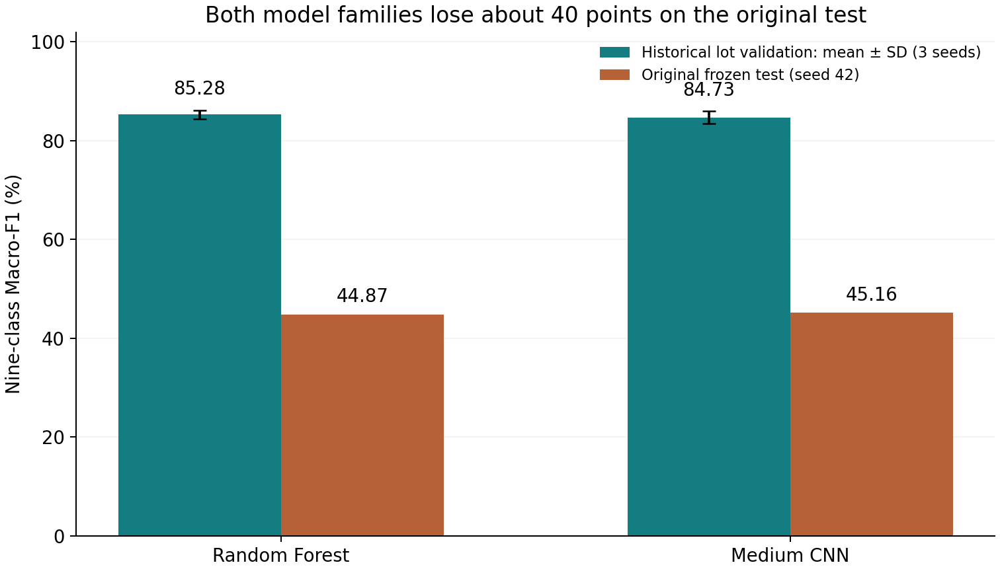
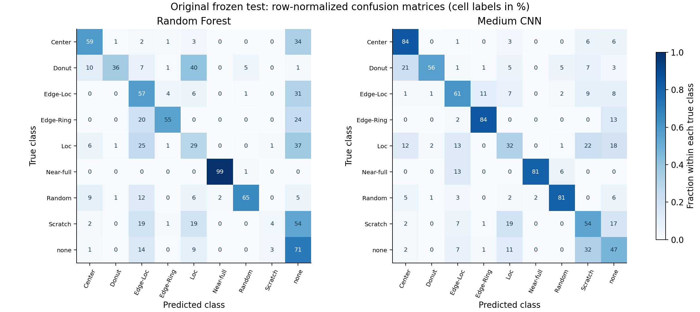
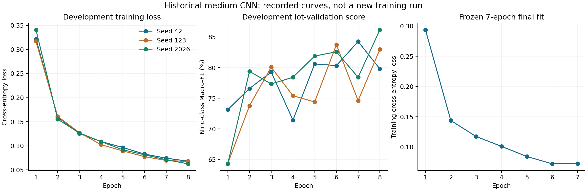
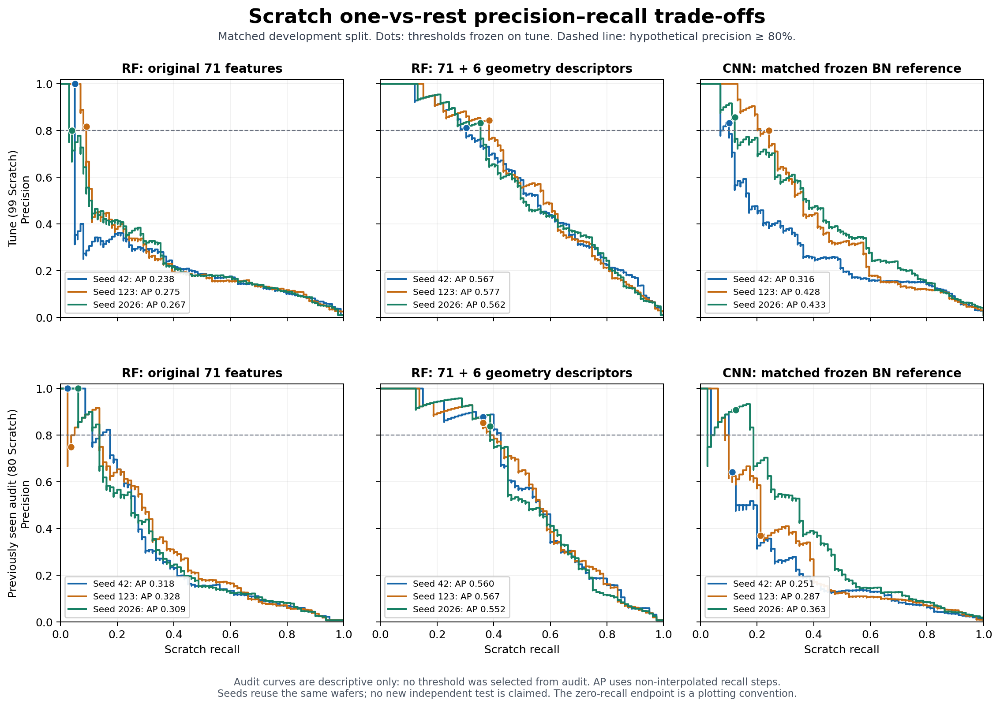

# Reliable Wafer Defect Classification: Generalization, Rare-Class Detection, and Decision Trade-offs

**Final delivery · 24 October 2026.** Research and engineering case study; no production-readiness claim.

## Executive finding

Both historical model families generalized poorly from lot validation to the original test: RF Macro-F1 fell from **85.28% to 44.87%**, and a 111,625-parameter CNN from **84.73% to 45.16%**. The original frozen scores are preserved. Subsequent diagnosis exposed that test, so this report does not present a newly selected model as independently tested.

A bounded, development-only ablation found a useful direction: appending a fixed geometry block to the unchanged RF raised mean Scratch recall from **32.08% to 42.08%** on the previously observed audit and reduced normal total false positives from **12.35 to 7.17 per 1,000**. All three seeds improved both point estimates. This is encouraging exploratory evidence, not proof of future-lot performance. An additional 80%-precision threshold rule failed the joint recall/normal-error requirements relative to that model's argmax and was not adopted.

## 1. Data, identity and evaluation boundaries

The public WM-811K audit contains 811,457 maps and 172,950 labeled rows. The fixed label order is Center, Donut, Edge-Loc, Edge-Ring, Loc, Near-full, Random, Scratch, none. Missing labels do not mean normal.

The unchanged original development/test designation contains 54,355/118,595 labeled wafers and 5,809/4,953 lots, with zero shared lots. Development class supports are 3,462 / 409 / 2,417 / 8,554 / 1,620 / 54 / 609 / 500 / 36,730; test supports are 832 / 146 / 2,772 / 1,126 / 1,973 / 95 / 257 / 693 / 110,701. Normal prevalence rises from 67.57% to 93.34%, while Scratch prevalence falls from 0.92% to 0.58%. Accuracy therefore obscures rare-class performance.

The audit recorded 3,250 duplicate-content hash groups, including 14 label-conflict groups covering 28 rows; 3,158 test rows have map content also present in development. Equal image content is not proof of equal wafer identity or erroneous copying. The original test was preserved. A predeclared nonidentical-map sensitivity subset of 115,437 test rows produced RF/CNN Macro-F1 44.43%/44.88%; it did not remove the generalization failure.

The new exploratory comparison uses a fixed lot/exact-map connected-component partition: **31,457 train / 11,307 tune / 11,591 audit**. Train/tune/audit have no shared rows, lots, exact-map hashes or components. Tune has 99 Scratch and 7,959 normal wafers; audit has **80 Scratch, 7,991 normal and only 7 Near-full wafers**. Three model seeds share those same wafers. This audit was previously inspected during repair work and is explicitly exploratory. Historical lot-validation scores and these scores estimate different evaluation constructions.

Sources: [historical audit](../results/historical/scope_audit.json), [evaluation history](../docs/EVALUATION_HISTORY.md), [fixed split reference](../data-reference/README.md).

## 2. Historical RF and CNN comparison

The preserved 30-run classical baseline supplied the 71-feature RF: 200 trees, unlimited depth, minimum leaf size 2, sqrt feature sampling and balanced_subsample class weights. The compact CNN has three convolution/BatchNorm/ReLU/max-pooling blocks and a nine-class head. Separate valid-die and failed-die masks are square-padded and area-resized to 64×64. The historical 18-run CNN matrix reused the lot-validation partitions, with a frozen eight-epoch search budget. The selected final CNN was trained for seven epochs on all development data, using the median selected development epoch.

| Historical metric | RF | CNN |
|---|---:|---:|
| Lot-validation Macro-F1, mean ± sample SD | 85.28 ± 0.88% | 84.73 ± 1.28% |
| Original frozen test Macro-F1 | 44.87% | 45.16% |
| Original test accuracy | 69.71% | 47.79% |
| Original test Scratch recall | 3.90% (27/693) | 53.97% (374/693) |
| Original test Scratch precision | 0.69% | 1.03% |

The saved freeze at 06:48:42 UTC preceded first test processing at 07:42:49 UTC on 22 October 2026. These historical final results were not rerun in this delivery. The small CNN Macro-F1 advantage does not establish statistically significant superiority. Full nine-class precision/recall/F1/support and confusion counts are [preserved](../results/historical/cnn_and_final/final_test_per_class.csv).

Historical CPU final fitting took 35.95 seconds for RF and 3,207.65 seconds for CNN. Full-test prediction took 1.44/409.82 seconds, **excluding** feature/image preparation of 40.89/74.13 seconds. These are single-run measurements on the recorded historical environment, not optimized serving benchmarks or current-laptop timings. Training histories and [environment](../results/historical/cnn_and_final/environment.json) are retained.

## 3. Failure diagnosis and rejected repairs

Normal size coverage is a major observed discrepancy: 70.60% of original-test normals have exact dimensions absent from development normals, and 97.31% of CNN normal→Scratch errors belong to size groups with only 0–24 development-normal examples. These are associations, not causal attribution. A BatchNorm-statistics diagnostic reduced selected false alarms but also reduced true Scratch recall from 53.97% to 12.12%, showing why a normal-only improvement is inadequate.

Two earlier development repair rounds are retained, including their failures. A GroupNorm/augmentation/averaging/weighting candidate passed its screen but failed the joint constraints after refitting in all three paired comparisons. Refit Scratch TP changed 51→50, 39→52 and 67→45; normal total FP changed 61→27, 9→34 and 1,633→29. The project did not hide the loss of true scratches or the shift of false alarms into other defect classes. [Error analysis](../docs/ERROR_ANALYSIS.md) distinguishes calculations, AI inspection and unresolved explanations.

## 4. Hypothesis-driven geometry ablation

**Hypothesis.** Explicit line structure can improve Scratch discrimination while preserving normal specificity. The original 71 features already contain defect-coordinate covariance, so PCA anisotropy is a deterministic re-expression, not new observational information.

**Method.** Add one fixed six-feature block: PCA anisotropy, maximum narrow-strip failed-point share, excess share relative to valid-die occupancy, robust axial span, axial occupancy and RMS width. Directions are fixed at 0°–175° in 5° increments; width and axial bins are two die pitches, with two fixed phase offsets. The five strip descriptors are zero for fewer than three failed points; PCA remains defined for two distinct failures. No direction-grid or width tuning follows scores. All 54,355 development map hashes were checked, and 25 original-feature rows replayed exactly. PCA reconstruction from original moments differed by at most 8.7×10⁻⁸.

Only six new RF fits were run: original71 versus geometry77 for seeds 42, 123 and 2026, holding split, hyperparameters and class weighting constant. The existing natural/BatchNorm seven-epoch CNN predictions were reused only after proving their training indices matched the current 31,457 rows. Old historical checkpoints could not be used as matched baselines because their training partitions overlapped this audit.

**Evidence: previously observed development audit, averages over model seeds.**

| Model / nine-class argmax | Macro-F1 | Scratch precision | Scratch recall | Scratch AP | Normal→any / 1,000 | Normal→Scratch / 1,000 |
|---|---|---|---|---|---|---|
| RF · 71 original features | 83.88% | 50.27% | 32.08% | 0.3186 | 12.35 | 0.584 |
| RF · 71 + 6 geometry features | 87.22% | 90.14% | 42.08% | 0.5599 | 7.17 | 0.125 |
| CNN · matched training rows | 82.39% | 20.10% | 49.58% | 0.3004 | 33.12 | 20.231 |

Paired RF71→RF77 Scratch TP counts were **25→31, 26→35, 26→35** out of 80. Normal total FP were **108→61, 90→55, 98→56** out of 7,991. Normal→Scratch counts were **9→1, 3→1, 2→1**. Every old normal→Scratch error became normal; none became another defect on audit. Each seed nevertheless introduced one new normal→Scratch error, so error identity was also checked.

The paired component bootstrap for the mean seed-wise change gives Scratch recall **+10.00 percentage points**, descriptive 95% interval **+0.85 to +19.83 points**, and normal total FPR **−0.517 percentage points**, interval **−0.892 to −0.211 points**. Resampling clusters preserves related rows and does not count seeds as extra data. These intervals are conditional on this selected, already-seen development setup and do not account for the history of model exploration.

**Interpretation and limits.** The block has consistent incremental value here. The experiment cannot attribute gains to PCA alone or separate the six features' effects. It does not validate the new candidate on the original test, future lots or a fresh refit. One seed's Scratch-recall interval includes zero; modest rare-class support remains consequential. All 13 small audit Scratch wafers (maximum side ≤32 dies) remain missed, and the ≥200-failed-die subgroup worsens from 12/12/12 to 10/11/11 hits. Well-covered normal-size errors also rise slightly from 3/3/4 to 6/4/5. Gains are not uniform across cohorts. No further model search was performed.

Feature extraction took 403.84 seconds for 54,355 maps. Four RF fits recorded 17.6–25.3 seconds; two recorded anomalous wall times of 5,522.8 and 8,021.1 seconds. Their logs are preserved. System suspension/load is a possible explanation but was not verified; no speed claim is based on those measurements and the fits were not repeated to beautify timing.

Sources: [protocol](../results/geometry/protocol.json), [full metrics](../results/geometry/metrics.csv), [paired estimates and intervals](../results/geometry/conclusion.json), [per-class metrics](../results/geometry/per_class.csv), [confusions](../results/geometry/confusions.csv).

## 5. Scratch precision–recall decisions

Average Precision is the non-interpolated step area over tied-score boundaries, not trapezoidal PR area. The one-vs-rest positive is Scratch; every other class is negative. Normal→Scratch per 1,000 divides false Scratch alarms on true normals by the number of true normals, not all negatives. Normal→any-defect is a separate full-system quantity.

The **80% precision floor is hypothetical**, not a factory cost agreement. For each model/seed, search every distinct tune Scratch score with a nonempty predicted-positive set; select maximum recall satisfying empirical precision ≥80%, breaking ties by higher precision then higher threshold. Freeze all nine thresholds before this round's audit probability export. An empty-positive classifier is not treated as feasible precision 1. Thresholds belong to a particular fitted model and are not transferred to a refit.

| Model | Seed | Frozen threshold | Audit precision | Audit recall | Normal→Scratch / 1,000 |
|---|---|---|---|---|---|
| rf_original71 | 42 | 0.586883 | 100.00% | 2.50% | 0.000 |
| rf_original71 | 123 | 0.510995 | 75.00% | 3.75% | 0.000 |
| rf_original71 | 2026 | 0.541258 | 100.00% | 6.25% | 0.000 |
| rf_linearity77 | 42 | 0.362889 | 87.88% | 36.25% | 0.375 |
| rf_linearity77 | 123 | 0.339481 | 85.29% | 36.25% | 0.250 |
| rf_linearity77 | 2026 | 0.361369 | 83.78% | 38.75% | 0.501 |
| cnn_bn_natural_7ep | 42 | 0.838189 | 64.29% | 11.25% | 0.250 |
| cnn_bn_natural_7ep | 123 | 0.438253 | 36.96% | 21.25% | 1.377 |
| cnn_bn_natural_7ep | 2026 | 0.895737 | 90.91% | 12.50% | 0.000 |

Every selected threshold met the floor on tune; some RF71/CNN audit operating points did not. The RF77 fixed thresholds retained 36.25–38.75% recall at 83.78–87.88% precision on audit. This is a point estimate, not an 80% lower-confidence-bound guarantee.

For the complete nine-class Scratch-priority rule, predict Scratch if its score reaches the frozen threshold; otherwise choose the largest remaining eight scores. Recomputing all classes changes the conclusion: compared with RF77 argmax, its threshold rule changes Scratch TP **31→29, 35→29, 35→31**, normal total FP **61→63, 55→56, 56→59**, and normal→Scratch FP **1→3, 1→2, 1→4**. Thus the threshold is an explanatory trade-off, **not an accepted repair**. Across all 18 tune/audit model-seed comparisons, no threshold rule passed the original joint noninferiority requirements. For CNN audit seeds, 125/4/209 old normal→Scratch errors merely became other defects.

Sources: [selection freeze](../results/protocol_pr/threshold_selection.json), [all nine-class metrics](../results/protocol_pr/nine_class_results.csv), [per-class metrics](../results/protocol_pr/per_class_metrics.csv), [threshold grid](../results/protocol_pr/threshold_grid.csv), [paired decision costs](../results/protocol_pr/decision_tradeoffs.csv).

## 6. Engineering, verification and completion

The reusable `waferdefect` package includes source-bound historical feature/CNN implementations, fixed configurations, validated map access, component splitting, training-only imputation, evaluation, decision freezing and original-test exposure guards. Large raw data and weights are excluded from Git. A small real-data pipeline run is labeled engineering verification and contributes no scientific performance claim. [Reproduction instructions](../docs/REPRODUCIBILITY.md) separate metric replay, retraining and historical reproduction.

Independent metric verification passed **14,317 checks with zero failures**, covering all 18 probability records, 36 complete nine-class decisions, alternative threshold search, sklearn AP agreement, confusion counts and freeze/source hashes. These checks address implementation consistency; they are not independent real-world validation. [Audit record](../results/protocol_pr/independent_pr_geometry_audit.json).

This delivery stops model expansion. Historical RF/CNN scores remain unchanged; the geometry direction remains exploratory; the threshold rule is rejected as a repair. Further confirmation requires genuinely new lots/size families, expert label adjudication and an agreed cost policy. AI assistance and suggested personal verification exercises are [explicitly disclosed](../docs/AI_ASSISTANCE.md).
